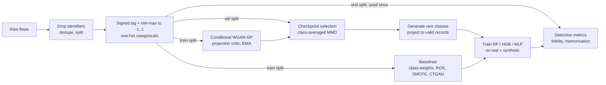

# SGAN-IDS: Generating rare attacks for intrusion detection

[](https://github.com/ZackHiRo/SGAN-IDS/actions/workflows/ci.yml)

Network intrusion-detection datasets are extremely imbalanced. In UNSW-NB15, *Worms*
is 0.07 % of training flows, so classifiers that score 99 % accuracy routinely miss
the rarest and often most damaging attacks.

This project trains a **class-conditional WGAN-GP** that generates realistic synthetic
flows for rare attack classes. It measures whether adding them improves detection on
**real, held-out traffic**, compared with class weights, random oversampling, SMOTE and
CTGAN under one shared protocol.

> Started as my Master's thesis (Research Master in Digital Sciences & AI, original
> code at tag [`thesis-v1`](../../tree/thesis-v1)). Version 2 is a methodological
> rework: the thesis evaluation leaked synthetic data into the test folds and its data
> loader silently dropped every rare class. [`docs/DECISIONS.md`](docs/DECISIONS.md)
> explains every design choice and what changed and why.

## Results

> **Status:** full runs on UNSW-NB15 and CIC-IDS2017 are pending (GPU). Tables and
> figures will be filled from `results/<dataset>/report.md` once generated. Nothing
> below is a placeholder number.

| Dataset | Best method (rare-class F1) | Δ vs. no augmentation | GAN vs. SMOTE |
|---|---|---|---|
| UNSW-NB15 | – | – | – |
| CIC-IDS2017 | – | – | – |

Every score is on the real test split, as mean ± std over 3 seeds, each seed
retraining the GAN and the classifiers. Each report also contains per-class F1,
synthetic-data fidelity (C2ST, MMD, precision/recall/coverage), a memorisation check
(distance to the closest training record) and training curves.

## How it works



- **Data:** UNSW-NB15 (official train/test partitions) and CIC-IDS2017 (stratified
  70/15/15). IPs, IDs and timestamps are removed, since they let a model recognise the
  capture instead of the attack.
- **Encoding:** heavy-tailed counts get a signed `log1p`, then every numeric column is
  scaled to [-1, 1], which is exactly the generator's `tanh` range. Categoricals are
  one-hot encoded and generated through a Gumbel-softmax. Every synthetic row, from the
  GAN or from SMOTE, is projected back to a valid record (integers rounded, one category
  per column).
- **Model:** a residual MLP generator and a WGAN-GP critic with projection conditioning
  (Miyato & Koyama, 2018). Classes are sampled with p ∝ n^0.5, the generator weights are
  averaged with an EMA, and the checkpoint is chosen by validation MMD rather than the
  GAN loss.
- **Evaluation:** classifiers train on real + synthetic training data and are scored
  once on the real test split. Synthetic data quality is measured per class:
  realism, diversity, novelty, and utility when the real rare rows are removed
  entirely.

## Quick start

```bash
python -m venv .venv && source .venv/bin/activate
pip install -e ".[dev]"            # add ,ctgan,tune for the CTGAN baseline and Optuna
pytest                              # 23 tests, ~30 s on CPU
sgan-ids run --config configs/toy.yaml   # full pipeline on synthetic toy data, ~1 min
```

Real data: put the CSVs under `datasets/` (see
[`scripts/download_data.md`](scripts/download_data.md)), then:

```bash
sgan-ids run --config configs/unsw_nb15.yaml          # prepare -> train -> evaluate -> report
sgan-ids train --config configs/unsw_nb15.yaml --set gan.n_steps=5000   # any value can be overridden
sgan-ids tune --config configs/unsw_nb15.yaml --trials 30              # Optuna on the validation split
bash scripts/run_gpu_pod.sh                            # both datasets, results copied to results/
bash scripts/run_ablations.sh                          # one design choice changed per run
```

Each run writes to `artifacts/<name>/`: the resolved config, the encoded splits, one
generator per seed, the result CSVs, `report.md` and figures.

## Repository layout

```text
src/sgan_ids/
├── data/          loaders (UNSW-NB15, CIC-IDS2017, toy), splitting, reversible encoder
├── models/        generator, projection critic, gradient penalty
├── training/      WGAN-GP loop, class-balanced sampler, validation-MMD checkpointing
├── augment/       none / class weights / ROS / SMOTE / CTGAN / GAN under one plan
├── evaluation/    detection metrics, fidelity (MMD, C2ST, PRDC), memorisation (DCR)
├── experiment.py  end-to-end orchestration and caching
├── report.py      markdown tables and figures
└── cli.py         `sgan-ids prepare|train|evaluate|report|run|tune`
configs/           one YAML per experiment; every run is fully described by its config
docs/DECISIONS.md  why each choice was made
tests/             encoder round-trips, loaders on raw-format CSVs, model invariants, metrics, end-to-end run
```

## References

- Gulrajani et al., *Improved Training of Wasserstein GANs*, NeurIPS 2017.
- Miyato & Koyama, *cGANs with Projection Discriminator*, ICLR 2018.
- Xu et al., *Modeling Tabular Data using Conditional GAN* (CTGAN), NeurIPS 2019.
- Naeem et al., *Reliable Fidelity and Diversity Metrics for Generative Models*, ICML 2020.
- Chawla et al., *SMOTE: Synthetic Minority Over-sampling Technique*, JAIR 2002.
- Moustafa & Slay, *UNSW-NB15: a comprehensive data set for network intrusion detection systems*, MilCIS 2015.
- Sharafaldin et al., *Toward Generating a New Intrusion Detection Dataset and Intrusion Traffic Characterization* (CIC-IDS2017), ICISSP 2018.
- Engelen et al., *Troubleshooting an Intrusion Detection Dataset: the CICIDS2017 Case Study*, IEEE SPW 2021.

MIT License.
