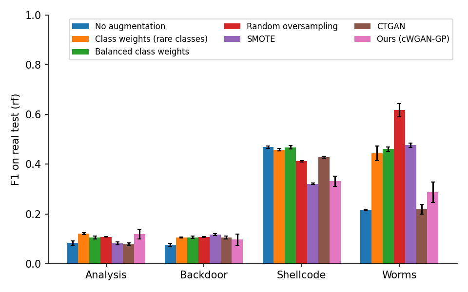
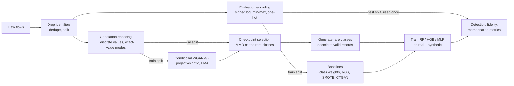

# SGAN-IDS: Generating rare attacks for intrusion detection

[](https://github.com/ZackHiRo/SGAN-IDS/actions/workflows/ci.yml)

Network intrusion-detection datasets are extremely imbalanced. In UNSW-NB15, *Worms*
is 0.07 % of training flows, so classifiers that score 99 % accuracy routinely miss
the rarest and often most damaging attacks.

This project asks a practical question: **does adding synthetic rare-attack traffic from
a class-conditional GAN help a detector catch rare attacks on real, held-out traffic,
compared with simpler fixes?** It trains a conditional WGAN-GP for mixed-type flow
records and compares it with class weights, random oversampling, SMOTE and CTGAN under
one shared protocol, on two datasets, with 3 seeds per configuration.

> Started as my Master's thesis (Research Master in Digital Sciences & AI, original
> code at tag [`thesis-v1`](../../tree/thesis-v1)). Version 2 is a methodological
> rework: the thesis evaluation leaked synthetic data into the test folds and its data
> loader silently dropped every rare class. [`docs/DECISIONS.md`](docs/DECISIONS.md)
> explains every design choice; [`docs/EXPERIMENT_LOG.md`](docs/EXPERIMENT_LOG.md)
> records all 8 GPU runs, what each one showed and what changed because of it.

## Results

**Short answer: no.** On these benchmarks, generative augmentation does not beat simple
rebalancing. Where there is room to improve (UNSW-NB15), weighting or duplicating the
rare classes works best. Where the rare classes are already separable (CIC-IDS2017),
every method lands in the same place.

**UNSW-NB15**: rare-class F1 (macro over Analysis, Backdoor, Shellcode, Worms) on the
official test split, mean ± std over 3 seeds:

| Method | Random forest | Gradient boosting | MLP | Δ vs. none (pairs improved) |
|---|---|---|---|---|
| No augmentation | 0.211 ± 0.002 | 0.172 ± 0.008 | 0.212 ± 0.017 | |
| Class weights (rare classes) | 0.282 ± 0.009 | 0.280 ± 0.014 | n/a* | **+0.090 (6/6)** |
| Random oversampling | **0.311 ± 0.007** | **0.330 ± 0.005** | 0.147 ± 0.008 | +0.065 (6/9) |
| SMOTE | 0.249 ± 0.001 | 0.252 ± 0.002 | 0.126 ± 0.007 | +0.011 (6/9) |
| CTGAN (one model per class) | 0.208 ± 0.007 | 0.248 ± 0.055 | 0.188 ± 0.051 | +0.016 (5/9) |
| **cWGAN-GP (this project)** | 0.209 ± 0.012 | 0.247 ± 0.052 | 0.162 ± 0.020 | +0.007 (4/9) |

<sub>*scikit-learn 1.6's MLP does not accept sample weights. Full tables, including
scikit-learn's "balanced" weights (+0.086, 6/6): [`results/unsw_nb15/report.md`](results/unsw_nb15/report.md).</sub>



**CIC-IDS2017** (Bot, Web Attack): every method scores 0.960–0.966 rare-class F1 with a
random forest (no augmentation: 0.963). Gradient boosting starts lower (0.891) and any
rebalancing brings it to 0.952–0.964. See [`results/cic_ids2017/report.md`](results/cic_ids2017/report.md).

### What I learned

1. **The ceiling is in the data, not the generator.** 74–77 % of UNSW-NB15's Analysis
   and Backdoor training rows share their exact feature vector with a row of another
   class, so no method lifts their F1 above 0.14. Worms sits inside Exploits
   territory: a classifier trained on real data recognises only 14 % of real held-out
   Worms. More realistic synthetic Worms land in the same place and get the same
   treatment.
2. **Realism is not utility.** Our GAN's rare-class samples are far closer to real
   traffic than CTGAN's (classifier two-sample AUC 0.94 vs 1.00; sample precision 0.71 vs
   0.01; a classifier trained on its samples alone reaches 0.175 rare-class F1 vs 0.003)
   and they are novel, not copies (distance-to-closest-record ratio 1.8). Detection
   still did not improve beyond what duplicating real rows gives.
3. **Gains concentrate on one class.** Oversampling took Worms (108 training rows) from
   0.22 to 0.62 F1, while every row-adding method *hurt* Shellcode (0.47 → 0.32–0.43, random forest).
   A macro average hides this; the report shows it per class.
4. **Most of the work was making the comparison fair.** Each GPU run surfaced a flaw
   that would have changed the conclusion: swapped train/test files on a dataset mirror,
   checkpoint selection on classes that are never generated, a GAN emitting TTL values
   that never occur (synthetic rows 100 % detectable), and a CTGAN baseline whose
   conditional sampling returned the requested class in only 0.05–3 % of draws. All of
   them are in the experiment log.

## How it works



- **Data:** UNSW-NB15 (official train/test partitions) and CIC-IDS2017 (stratified
  70/15/15). IPs, IDs and timestamps are removed, since they let a model recognise the
  capture instead of the attack. Only the named rare classes are augmented, all methods
  to the same target of 10,000 rows.
- **Two encodings:** classifiers, baselines and metrics use a compact encoding (signed
  `log1p` for heavy-tailed counts, min-max to [-1, 1], one-hot categoricals). The GAN
  alone uses a wider one that also generates low-cardinality numbers (TTLs, flags) as
  categories and frequent exact values (e.g. jitter = 0) through selectors, so it can
  only emit values that real traffic takes. Its output is decoded to raw values and
  re-encoded like any other synthetic row.
- **Model:** a residual MLP generator and a WGAN-GP critic with projection conditioning
  (Miyato & Koyama, 2018). Classes are sampled with p ∝ n^0.5, generator weights are
  averaged with an EMA, and the checkpoint is chosen by validation MMD on the rare
  classes, not by the GAN loss.
- **Evaluation:** classifiers train on real + synthetic training data and are scored
  once on the real test split. Synthetic data is also measured per class for realism
  (C2ST, MMD, precision/density), diversity (recall/coverage), novelty (distance to
  closest record) and utility on its own (train on synthetic, test on real).

## Quick start

```bash
python -m venv .venv && source .venv/bin/activate
pip install -e ".[dev]"            # add ,ctgan,tune for the CTGAN baseline and Optuna
pytest                              # 50 tests, ~1.5 min on CPU
sgan-ids run --config configs/toy.yaml   # full pipeline on synthetic toy data, ~1 min
```

Real data: put the CSVs under `datasets/` (see
[`scripts/download_data.md`](scripts/download_data.md)), then:

```bash
sgan-ids run --config configs/unsw_nb15.yaml          # prepare -> train -> evaluate -> report
sgan-ids train --config configs/unsw_nb15.yaml --set gan.n_steps=5000   # any value can be overridden
sgan-ids tune --config configs/unsw_nb15.yaml --trials 30              # Optuna on the validation split
bash scripts/run_gpu_pod.sh                            # both datasets, results copied to results/
bash scripts/run_ablations.sh                          # one design choice changed per run
```

On Google Colab, follow [`docs/COLAB.md`](docs/COLAB.md): outputs go to Google Drive and an
interrupted run resumes without refitting anything.

Each run writes to `artifacts/<name>/`: the resolved config, the encoded splits, one
generator per seed, the result CSVs, `report.md` and figures.

## Repository layout

```text
src/sgan_ids/
├── data/          loaders (UNSW-NB15, CIC-IDS2017, toy), splitting, reversible encoder
├── models/        generator, projection critic, gradient penalty
├── training/      WGAN-GP loop, class-balanced sampler, validation-MMD checkpointing
├── augment/       none / class weights / ROS / SMOTE / CTGAN / GAN under one plan
├── evaluation/    detection metrics, fidelity (MMD, C2ST, PRDC), memorisation (DCR)
├── experiment.py  end-to-end orchestration and caching
├── report.py      markdown tables and figures
└── cli.py         `sgan-ids prepare|train|evaluate|report|run|tune`
configs/           one YAML per experiment; every run is fully described by its config
docs/DECISIONS.md  why each choice was made
docs/EXPERIMENT_LOG.md  every GPU run: setup, findings, what changed
results/           final reports (results/<dataset>/report.md); earlier runs in results/archive/
tests/             encoder round-trips, loaders on raw-format CSVs, model invariants, metrics, end-to-end run
```

## References

- Gulrajani et al., *Improved Training of Wasserstein GANs*, NeurIPS 2017.
- Miyato & Koyama, *cGANs with Projection Discriminator*, ICLR 2018.
- Xu et al., *Modeling Tabular Data using Conditional GAN* (CTGAN), NeurIPS 2019.
- Zhao et al., *CTAB-GAN: Effective Table Data Synthesizing*, ACML 2021.
- Naeem et al., *Reliable Fidelity and Diversity Metrics for Generative Models*, ICML 2020.
- Chawla et al., *SMOTE: Synthetic Minority Over-sampling Technique*, JAIR 2002.
- Moustafa & Slay, *UNSW-NB15: a comprehensive data set for network intrusion detection systems*, MilCIS 2015.
- Sharafaldin et al., *Toward Generating a New Intrusion Detection Dataset and Intrusion Traffic Characterization* (CIC-IDS2017), ICISSP 2018.
- Engelen et al., *Troubleshooting an Intrusion Detection Dataset: the CICIDS2017 Case Study*, IEEE SPW 2021.

MIT License.
