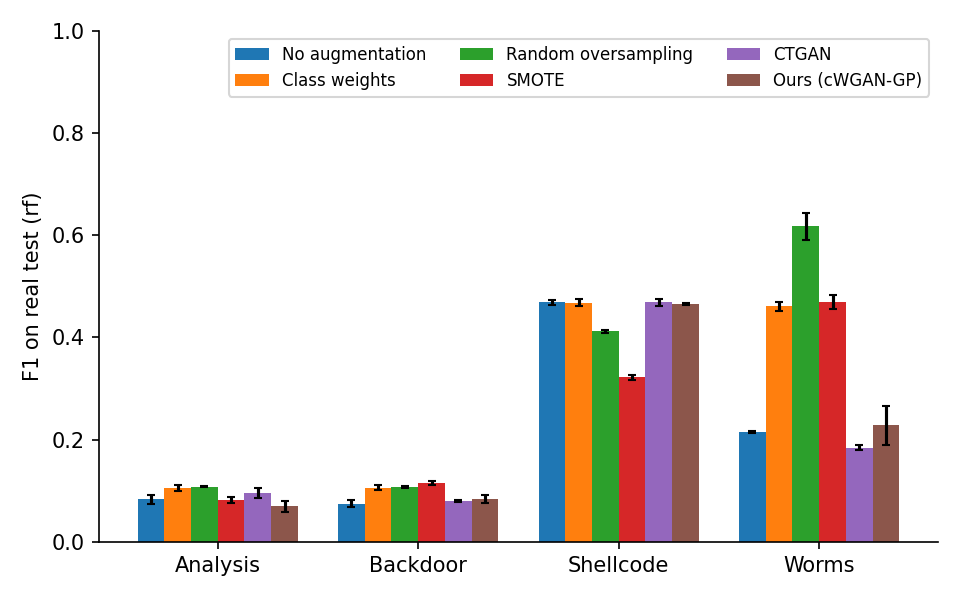
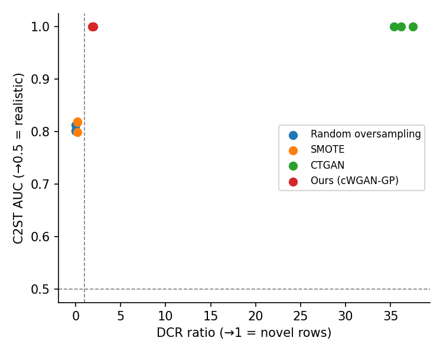
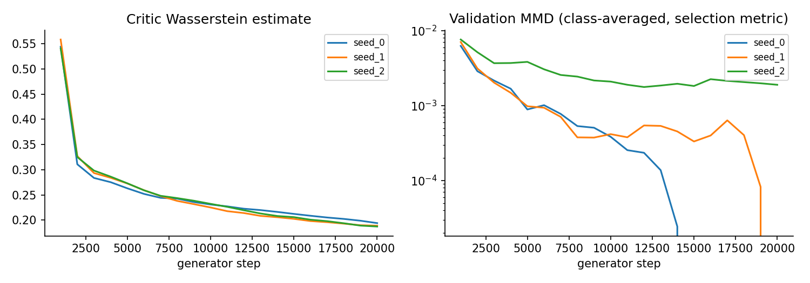

# Results: unsw_nb15

Dataset `unsw_nb15`, split: official. Rows: {'train': 91579, 'val': 16161, 'test': 82332}. Encoded features: 60.

Augmented classes (rows added): {'Analysis': 8645, 'Backdoor': 8695, 'Shellcode': 9073, 'Worms': 9892}

Seeds: [0, 1, 2]. Values are mean ± std over seeds; all scores are on the real, untouched test split.

## Detection (train on real + synthetic, test on real)

| classifier | method | macro_f1 | rare_macro_f1 | rare_macro_recall | balanced_accuracy |
|---|---|---|---|---|---|
| rf | none | 0.477 ± 0.003 | 0.211 ± 0.002 | 0.321 ± 0.003 | 0.525 ± 0.000 |
| rf | class_weight | 0.508 ± 0.003 | 0.285 ± 0.006 | 0.468 ± 0.015 | 0.572 ± 0.005 |
| rf | ros | 0.518 ± 0.003 | 0.311 ± 0.007 | 0.571 ± 0.009 | 0.611 ± 0.003 |
| rf | smote | 0.490 ± 0.000 | 0.247 ± 0.002 | 0.616 ± 0.009 | 0.624 ± 0.003 |
| rf | ctgan | 0.476 ± 0.002 | 0.207 ± 0.002 | 0.341 ± 0.013 | 0.532 ± 0.004 |
| rf | gan | 0.477 ± 0.005 | 0.212 ± 0.011 | 0.335 ± 0.006 | 0.530 ± 0.002 |
| hgb | none | 0.453 ± 0.010 | 0.172 ± 0.008 | 0.369 ± 0.021 | 0.545 ± 0.012 |
| hgb | class_weight | 0.488 ± 0.003 | 0.270 ± 0.005 | 0.695 ± 0.003 | 0.654 ± 0.001 |
| hgb | ros | 0.526 ± 0.002 | 0.330 ± 0.005 | 0.606 ± 0.015 | 0.625 ± 0.005 |
| hgb | smote | 0.495 ± 0.002 | 0.259 ± 0.004 | 0.613 ± 0.011 | 0.625 ± 0.004 |
| hgb | ctgan | 0.498 ± 0.009 | 0.257 ± 0.025 | 0.389 ± 0.040 | 0.553 ± 0.014 |
| hgb | gan | 0.505 ± 0.009 | 0.281 ± 0.022 | 0.454 ± 0.007 | 0.575 ± 0.003 |
| mlp | none | 0.474 ± 0.031 | 0.212 ± 0.017 | 0.317 ± 0.038 | 0.523 ± 0.019 |
| mlp | ros | 0.437 ± 0.001 | 0.147 ± 0.008 | 0.665 ± 0.014 | 0.632 ± 0.005 |
| mlp | smote | 0.437 ± 0.006 | 0.141 ± 0.011 | 0.655 ± 0.005 | 0.628 ± 0.004 |
| mlp | ctgan | 0.461 ± 0.010 | 0.168 ± 0.019 | 0.237 ± 0.080 | 0.501 ± 0.019 |
| mlp | gan | 0.423 ± 0.006 | 0.137 ± 0.005 | 0.547 ± 0.022 | 0.579 ± 0.011 |

### Rare-class F1 change vs. no augmentation (paired by seed and classifier)

| method | mean Δ rare-F1 | seeds×classifiers improved |
|---|---|---|
| class_weight | +0.086 | 6/6 |
| ros | +0.065 | 6/9 |
| smote | +0.017 | 6/9 |
| ctgan | +0.012 | 3/9 |
| gan | +0.012 | 5/9 |

### Per-class F1 on augmented classes (rf)

| method | Analysis | Backdoor | Shellcode | Worms |
|---|---|---|---|---|
| No augmentation | 0.084 | 0.074 | 0.469 | 0.216 |
| Class weights | 0.105 | 0.106 | 0.468 | 0.461 |
| Random oversampling | 0.108 | 0.107 | 0.412 | 0.618 |
| SMOTE | 0.082 | 0.116 | 0.322 | 0.469 |
| CTGAN | 0.095 | 0.081 | 0.468 | 0.185 |
| Ours (cWGAN-GP) | 0.069 | 0.084 | 0.465 | 0.228 |

### Per-class F1 on augmented classes (hgb)

| method | Analysis | Backdoor | Shellcode | Worms |
|---|---|---|---|---|
| No augmentation | 0.048 | 0.085 | 0.446 | 0.109 |
| Class weights | 0.088 | 0.109 | 0.290 | 0.594 |
| Random oversampling | 0.111 | 0.099 | 0.446 | 0.667 |
| SMOTE | 0.085 | 0.108 | 0.352 | 0.491 |
| CTGAN | 0.111 | 0.090 | 0.472 | 0.354 |
| Ours (cWGAN-GP) | 0.105 | 0.094 | 0.493 | 0.431 |

### Per-class F1 on augmented classes (mlp)

| method | Analysis | Backdoor | Shellcode | Worms |
|---|---|---|---|---|
| No augmentation | 0.083 | 0.119 | 0.449 | 0.198 |
| Random oversampling | 0.067 | 0.117 | 0.251 | 0.151 |
| SMOTE | 0.086 | 0.094 | 0.268 | 0.116 |
| CTGAN | 0.066 | 0.068 | 0.380 | 0.157 |
| Ours (cWGAN-GP) | 0.112 | 0.095 | 0.253 | 0.090 |

### How separable are the rare classes?

Share of each rare class's test rows whose exact feature vector also occurs in the training data under another label. No classifier can be sure of those rows, whatever augmentation is used.

| class | n_test | test_seen_with_other_label | test_seen_with_same_label_only | test_unseen | train_shared_with_other_label |
|---|---|---|---|---|---|
| Analysis | 677 | 17.1 % | 0.0 % | 82.9 % | 73.9 % |
| Backdoor | 583 | 1.4 % | 0.0 % | 98.6 % | 76.6 % |
| Shellcode | 378 | 0.3 % | 2.9 % | 96.8 % | 0.5 % |
| Worms | 44 | 0.0 % | 0.0 % | 100.0 % | 7.4 % |

## Synthetic data quality (augmented classes, vs. real test rows)

C2ST AUC: 0.5 = indistinguishable from real. DCR ratio: ~1 = as novel as real held-out traffic, 0 = copies of training rows.

| method | c2st_auc | mmd | precision | recall | coverage | wasserstein | correlation_gap | dcr_ratio | exact_copy_rate |
|---|---|---|---|---|---|---|---|---|---|
| ros | 0.805 ± 0.006 | 0.037 ± 0.001 | 0.759 ± 0.003 | 0.320 ± 0.005 | 0.631 ± 0.002 | 0.048 ± 0.002 | 0.059 ± 0.000 | 0.000 ± 0.000 | 1.000 ± 0.000 |
| smote | 0.812 ± 0.011 | 0.036 ± 0.003 | 0.780 ± 0.008 | 0.319 ± 0.018 | 0.633 ± 0.002 | 0.045 ± 0.003 | 0.058 ± 0.000 | 0.226 ± 0.004 | 0.146 ± 0.005 |
| ctgan | 1.000 ± 0.000 | 0.329 ± 0.006 | 0.046 ± 0.002 | 0.960 ± 0.024 | 0.098 ± 0.017 | 0.204 ± 0.003 | 0.191 ± 0.008 | 36.327 ± 1.061 | 0.000 ± 0.000 |
| gan | 1.000 ± 0.000 | 0.038 ± 0.001 | 0.736 ± 0.014 | 0.468 ± 0.027 | 0.578 ± 0.018 | 0.049 ± 0.001 | 0.073 ± 0.004 | 1.908 ± 0.060 | 0.000 ± 0.000 |

## Train on synthetic only (real rows of augmented classes removed, RF)

| method | rare_macro_f1 | rare_macro_recall | macro_f1 |
|---|---|---|---|
| ros | 0.313 ± 0.009 | 0.568 ± 0.011 | 0.519 ± 0.004 |
| smote | 0.243 ± 0.003 | 0.589 ± 0.008 | 0.488 ± 0.001 |
| ctgan | 0.000 ± 0.000 | 0.000 ± 0.000 | 0.398 ± 0.000 |
| gan | 0.004 ± 0.001 | 0.002 ± 0.001 | 0.398 ± 0.004 |

## GAN training

